  

  
  
  

## whoami

Self-taught offensive security. Most of my time goes into **Active Directory**,
**Windows internals** and **C2 tradecraft**: building the tooling I'm missing,
breaking it, and writing down what actually worked.

Certified **CRTO** and **CPTS**, plus four CyberWarfare Labs certifications
covering Windows internals, process injection, red team infrastructure and Azure
attack paths. Top 100 in Spain on Hack The Box.

## focus

- **Active Directory** — enumeration, ACL abuse, Kerberos, ADCS, trusts
- **Windows internals** — process injection, direct and indirect syscalls, API unhooking
- **Evasion** — AMSI/ETW bypass, payload encryption, anti-analysis
- **C2** — implant design, redirectors, OPSEC
- **Cloud** — Azure / Entra ID attack paths

## stack

  
  
  
  
  
  

## certifications

| Certification | Issuer |
| :--- | :--- |
| CRTO — Certified Red Team Operator | Zero-Point Security |
| CPTS — Certified Penetration Testing Specialist | Hack The Box |
| CWI-RTO — Certified Windows Internals Red Team Operator | CyberWarfare Labs |
| CPIA — Certified Process Injection Analyst | CyberWarfare Labs |
| CRT-ID — Red Team Infra Developer | CyberWarfare Labs |
| AZRTS — Azure Red Team Specialist | CyberWarfare Labs |

## selected work

- [**SUPERNMAP**](https://github.com/pequepadawans/SUPERNMAP) — concurrent nmap
  wrapper: phased scanning, background UDP, SPACE-key live dashboard. `Python`
- [**Receptor**](https://github.com/pequepadawans/Receptor) — HTTP exfiltration
  listener for CTFs with a split-screen terminal UI. `Python`

## writing

Lab notes, exam reviews and tooling write-ups:

- [CPTS review — the exam, the flags, the burnout](https://pequepadawans.pages.dev/posts/cpts-review)
- [Hermes: a self-improving AI agent on an old laptop](https://pequepadawans.pages.dev/posts/hermes-ai-secretary)
- [Hello world](https://pequepadawans.pages.dev/posts/hello-world)

→ **[pequepadawans.pages.dev](https://pequepadawans.pages.dev)**

---

  Open to junior red team roles · Madrid

